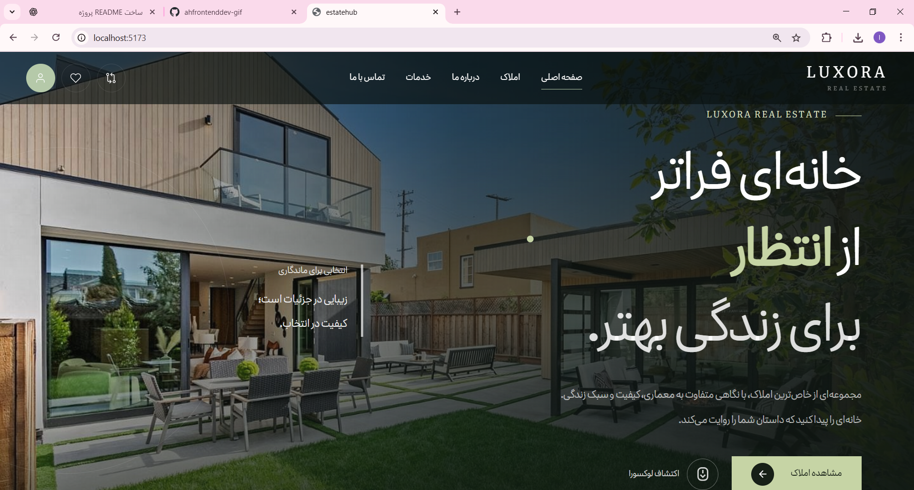
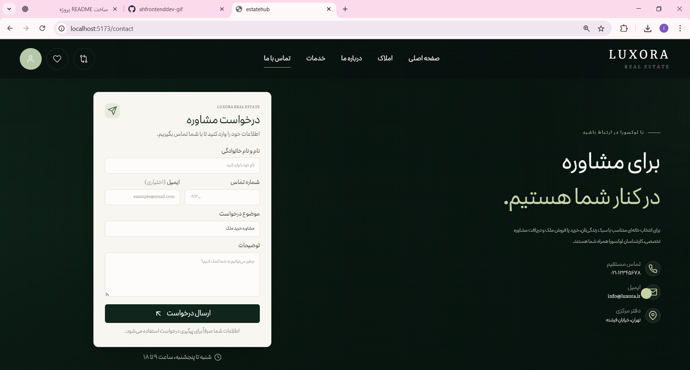
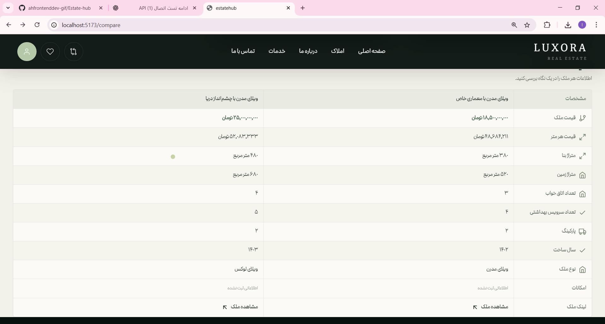

# EstateHub | لوکسورا

**سامانه معرفی، جستجو و مقایسه املاک**

EstateHub یک وب‌سایت مدرن و واکنش‌گرا در حوزه املاک است که با React توسعه داده شده است. این پروژه با هدف ارائه تجربه‌ای ساده، زیبا و کاربردی برای مشاهده، بررسی و مقایسه املاک طراحی شده است.

## پیش‌نمایش پروژه

### صفحه اصلی


### صفحه تماس با ما


### صفحه مقایسه املاک


## امکانات پروژه

- **نمایش املاک:** مشاهده فهرست املاک همراه با اطلاعات و مشخصات هر ملک.
- **صفحه جزئیات ملک:** نمایش توضیحات، مشخصات، تصاویر و اطلاعات مشاور هر ملک.
- **گالری تصاویر:** مشاهده تصاویر املاک با قابلیت جابه‌جایی بین تصاویر.
- **علاقه‌مندی‌ها:** افزودن املاک به فهرست علاقه‌مندی‌ها و مدیریت آن‌ها.
- **مقایسه املاک:** مقایسه هم‌زمان حداکثر سه ملک از نظر قیمت، متراژ، امکانات و سایر مشخصات.
- **احراز هویت:** رابط ورود و ثبت‌نام کاربران با مدیریت وضعیت ورود در LocalStorage.
- **صفحه تماس با ما:** ثبت درخواست مشاوره از طریق فرم تماس.
- **طراحی واکنش‌گرا:** سازگاری با اندازه‌های مختلف صفحه‌نمایش.
- **انیمیشن‌های تعاملی:** استفاده از انیمیشن‌های روان برای بهبود تجربه کاربری.
- **ساختار کامپوننت‌محور:** توسعه بخش‌های مختلف با کامپوننت‌های قابل استفاده مجدد.

## تکنولوژی‌های استفاده‌شده

| تکنولوژی | کاربرد |
|---|---|
| React | توسعه رابط کاربری |
| JavaScript | پیاده‌سازی منطق برنامه |
| Vite | ابزار توسعه و ساخت پروژه |
| Tailwind CSS | طراحی و استایل‌دهی |
| Redux Toolkit | مدیریت وضعیت سراسری |
| RTK Query | دریافت و مدیریت اطلاعات API |
| React Router | مدیریت مسیرها و صفحات |
| Motion | ایجاد انیمیشن و تعاملات |
| React Icons | استفاده از آیکون‌ها |
| MockAPI | شبیه‌سازی REST API و ذخیره اطلاعات املاک |

## راه‌اندازی پروژه

### پیش‌نیازها

- Node.js
- npm
- Git

### دریافت پروژه

```bash
git clone https://github.com/USERNAME/Estate-hub.git
cd Estate-hub
npm install
npm run dev
```

سپس آدرس محلی نمایش‌داده‌شده در ترمینال را در مرورگر باز کنید.

## دستورات قابل اجرا

| دستور | توضیحات |
|---|---|
| `npm run dev` | اجرای سرور توسعه |
| `npm run build` | ساخت نسخه نهایی پروژه |
| `npm run preview` | پیش‌نمایش نسخه نهایی |

## ارتباط با API

اطلاعات املاک از طریق MockAPI دریافت می‌شوند. برای مدیریت درخواست‌ها، دریافت اطلاعات و کش‌کردن داده‌ها از RTK Query استفاده شده است.

**آدرس اصلی API:**

```text
https://6af180fe11a6aa866e804b03.mockapi.io/api/
```

**مسیر دریافت املاک:**

```http
GET /properties
```

## نکات فنی

- مدیریت وضعیت سراسری با Redux Toolkit
- دریافت و مدیریت داده‌ها با RTK Query
- مسیریابی پویا برای صفحات جزئیات املاک
- ایجاد کامپوننت‌های قابل استفاده مجدد
- پیاده‌سازی سیستم علاقه‌مندی‌ها و مقایسه املاک
- پشتیبانی از رابط کاربری فارسی و راست‌چین (RTL)
- طراحی واکنش‌گرا با Tailwind CSS
- ایجاد انیمیشن‌های رابط کاربری با Motion
- مدیریت وضعیت ورود کاربر با LocalStorage

## توسعه‌های آینده

- پیاده‌سازی احراز هویت امن با بک‌اند اختصاصی
- افزودن فیلترهای پیشرفته برای جستجوی املاک
- بهبود اعتبارسنجی فرم‌ها
- افزودن تست‌های خودکار
- بهینه‌سازی تصاویر و سرعت بارگذاری
- استقرار پروژه روی سرویس میزبانی

## توسعه‌دهنده

**نام و نام خانوادگی**

توسعه‌دهنده فرانت‌اند

گیت‌هاب: [پروفایل GitHub](https://github.com/USERNAME)

---

این پروژه با هدف نمایش مهارت‌های توسعه فرانت‌اند، کار با React، مدیریت وضعیت، ارتباط با API و طراحی رابط کاربری مدرن توسعه داده شده است.
